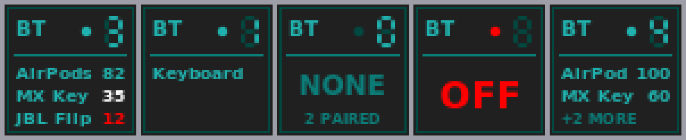

# wmbluetooth

A tiny [Window Maker](https://www.windowmaker.org/) dockapp that shows your **connected Bluetooth devices**
and their battery levels. There was no Bluetooth dockapp in Debian, so this one talks to BlueZ directly over
D-Bus. It is styled after the stock dark dockapps (`wmbattery`, `wmgtemp`): dark panel, teal seven-segment
digits with faint unlit segments.



* A seven-segment digit in the corner counts the connected devices.
* Each connected device is listed with its battery percentage (teal, white below 40%, red below 20%) when the
  device reports one.
* Up to three lines are shown; with more devices the last line reads `+N MORE`.
* The dot next to the digit is teal when something is connected, dim when nothing is, and red when Bluetooth is
  switched off (the panel then reads `OFF`). With nothing connected it shows how many devices are paired.

## Mouse

| Action       | Effect                                                              |
|--------------|---------------------------------------------------------------------|
| Left click   | Menu (rofi) of your paired devices: pick one to connect or disconnect |
| Middle click | Switch Bluetooth on or off                                          |

## Requirements

* Python 3 with `pycairo` and `PyGObject` (`python3-cairo`, `python3-gi` on Debian) for drawing and D-Bus
* BlueZ (`bluetoothd`) and `bluetoothctl`
* `rofi` for the click menu
* An X11 session running Window Maker (any dock-capable WM should work)

## Install and run

```
make install          # copies wmbluetooth to ~/.local/bin
wmbluetooth &
```

The icon first appears as a loose icon at the bottom of the screen. **Drag it into the Dock**, then right-click
it and choose *Settings...* to tick *Start when Window Maker is started* (or start it from your
`~/GNUstep/Library/WindowMaker/autostart`).

## Testing without a device

```
./wmbluetooth --render out.png                       # draw the real current state
./wmbluetooth --render out.png --fake '{"powered":true,"devices":[{"name":"AirPods","connected":true,"battery":80}]}'
make test
WMBT_DEBUG=1 wmbluetooth                             # log the events the widget receives to stderr
```

## How it works

A dockapp is a "withdrawn" X window: a 1x1 leader window carrying `WM_HINTS` (initial state *Withdrawn*, icon
window = a 58x58 window) and the class `DockApp`. Window Maker adopts the icon window into the Dock and draws
its own 64x64 tile around it, like it does for the stock dockapps.
The program talks to Xlib through `ctypes`, draws with Cairo, and polls BlueZ's `GetManagedObjects()` every
three seconds (every half second for a few seconds after you switch power, so the change shows quickly).

## License

MIT, see [LICENSE](LICENSE).
